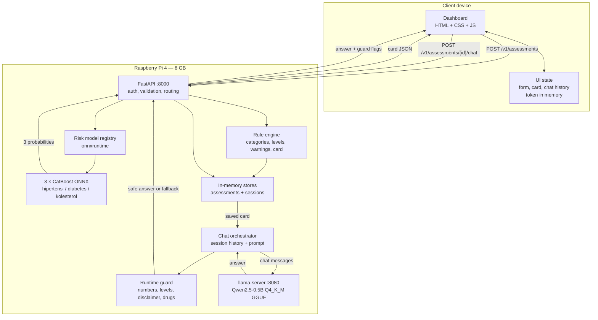
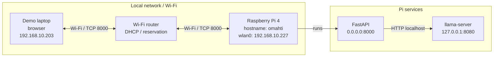
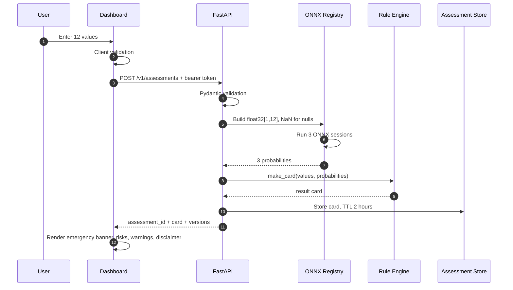
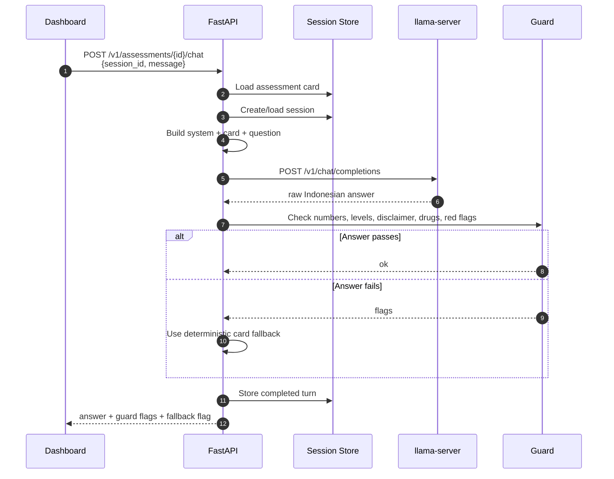

# System Architecture — Kartu Risiko Pi

This document describes the deployed inference system: the dashboard, the FastAPI service on the Raspberry Pi, the three tabular risk models, the rule engine, the Indonesian chatbot model, and the network path between them.

It covers the **deployment and inference architecture**, not the offline training notebooks.
For power-on, restart, and troubleshooting procedures, see [`STARTUP.md`](STARTUP.md).

---

## 1. Purpose

The system estimates three independent health risks from 12 user-entered values:

- hypertension,
- diabetes,
- high cholesterol.

It then turns the three probabilities into a deterministic **result card** and lets a small on-device LLM explain that card in Indonesian.

The LLM never computes or changes numbers. It only reads the card.

```text
12 values -> 3 ONNX risk models -> rule engine -> result card -> local LLM -> guarded answer
```

---

## 2. At a glance

```text
┌─────────────────────────────┐
│ Dashboard                   │
│ browser on the demo laptop  │
│ form / card / chat / token  │
└──────────────┬──────────────┘
               │ HTTP/JSON over Wi-Fi
               │ http://<pi-ip>:8000
               ▼
┌─────────────────────────────────────────────────────────────┐
│ Raspberry Pi 4 (8 GB), headless                             │
│                                                             │
│  FastAPI :8000                                              │
│   ├─ auth + validation                                      │
│   ├─ 3 × ONNX risk models (onnxruntime)                     │
│   ├─ deterministic rule engine -> result card               │
│   ├─ in-memory assessment/session stores                    │
│   └─ chat orchestrator + output guard                       │
│          │                                                  │
│          │ localhost only                                   │
│          ▼                                                  │
│  llama-server 127.0.0.1:8080                                │
│   └─ Qwen2.5-0.5B student, Q4_K_M GGUF                      │
│                                                             │
│  systemd: health-api.service + llama.service                │
└─────────────────────────────────────────────────────────────┘
```

There is no cloud dependency at runtime. The Pi does not call Hugging Face, Gemini, OpenRouter, or any external API.

---

## 3. Logical architecture



### Component responsibilities

| Component | Runs on | Responsibility |
|---|---|---|
| Dashboard | Laptop browser | Input form, client validation, card rendering, chat UI, settings |
| FastAPI | Pi | Auth, Pydantic validation, orchestration, card store, chat sessions, static hosting |
| `RiskRegistry` | Pi | Loads and verifies the three ONNX sessions, builds the 12-float vector |
| ONNX Runtime | Pi | Executes the exported CatBoost trees and returns probabilities |
| Rule engine | Pi | Converts probabilities and inputs into a fixed result card |
| `AssessmentStore` | Pi | Keeps cards in memory with a 2-hour TTL |
| `SessionStore` | Pi | Keeps chat turns in memory with a 30-minute TTL |
| `LlamaChat` | Pi | Calls the local llama.cpp OpenAI-compatible endpoint |
| `llama-server` | Pi | Runs the Qwen2.5-0.5B GGUF and applies the chat template |
| `guard.py` | Pi | Rejects unsafe or inconsistent LLM answers; provides a fallback |
| StaticFiles | Pi | Serves `dashboard/dist` at `/` |

---

## 4. Deployment topology



### Current demo values

| Item | Value |
|---|---|
| Pi hostname | `omahti` |
| Current Wi-Fi | `healthnet` (`AraHome Pandawa`) |
| Additional stored profile | `chapelure` |
| Current Pi IP | `192.168.10.227` |
| Dashboard URL | `http://192.168.10.227:8000/` |
| API port | `8000` (LAN) |
| llama-server port | `8080` (localhost only) |
| TLS | Not used on the isolated demo LAN |
| Internet at runtime | Not required |

The IP may change when the Pi moves to another network. The dashboard supports a configurable base URL, and the `/v1/health` endpoint can be used to test a new address.

### Network rules

- FastAPI binds `0.0.0.0:8000` so the laptop can reach it over the LAN.
- `llama-server` binds `127.0.0.1:8080`; it is **not** reachable from the laptop.
- UFW allows TCP 22 and 8000 from the current LAN subnet.
- `/etc/NetworkManager/dispatcher.d/90-ufw-lan` automatically adds UFW rules for the subnet of any Wi-Fi/Ethernet connection the Pi joins.
- The dashboard and API share an origin in production, so no CORS is required.
- CORS is only configured for the local dashboard development server at port 4173.

---

## 5. Risk-model deployment

The three risk models are trained offline with CatBoost and exported to ONNX.

| Artifact | Target | Runtime on Pi | Size |
|---|---|---|---|
| `models/hipertensi.onnx` | Hypertension | ONNX Runtime | ~677 KiB |
| `models/diabetes.onnx` | Diabetes | ONNX Runtime | ~677 KiB |
| `models/kolesterol_tinggi.onnx` | High cholesterol | ONNX Runtime | ~675 KiB |

### Input contract

```text
features: float32[1, 12]
```

The order comes from `data/final/meta.json`:

```text
age, male, bmi, sbp, dbp, smoker, waist, hdl,
fam_dm, fam_mi, vig_rec, mod_rec
```

Optional empty values are passed as `NaN`; they are never replaced with `0`. The CatBoost trees were trained with native missing-value handling.

### Output contract

```text
probabilities: seq(map(int64, tensor(float)))
```

CatBoost exports probabilities as a list of `{0: p0, 1: p1}` entries. The backend takes class `1` as the positive risk probability.

The three models are independent. The outputs are not mutually exclusive and do not sum to 1.

### Training-only components

CatBoost itself is not installed on the Pi. The `catboost` Python package is only needed to retrain the models. At runtime, `onnxruntime` executes the exported graphs.

---

## 6. Rule-engine deployment

`app/card.py` is a direct port of the notebook rule engine. It does not use a model.

It produces:

| Card field | Source |
|---|---|
| `pasien` | The 12 input values, formatted for the card |
| `kategori.tekanan_darah` | AHA/ACC thresholds (normal/elevated/stage 1/stage 2) |
| `kategori.bmi` | Asia-Pacific/Kemenkes thresholds |
| `kategori.lingkar_pinggang` | Central-obesity threshold by sex |
| `kategori.hdl` | Low/adequate threshold by sex |
| `risiko[d].probabilitas` | ONNX probability, 3 decimal places |
| `risiko[d].persen_perkiraan` | Nearest 5%, `<5%`, or `>95%` |
| `risiko[d].tingkat` | `rendah` / `sedang` / `tinggi` from `risk_levels.json` |
| `data_tidak_lengkap` | Missing optional fields |
| `peringatan` | Out-of-range values, SBP ≤ DBP, very-high BP |
| `disclaimer` | Fixed statistical-estimate disclaimer |

The rule engine is the only component allowed to turn numbers into risk levels and displayed percentages. The LLM receives the finished card.

---

## 7. Chatbot-model deployment

The student is a fine-tuned Qwen2.5-0.5B model published at:

```text
https://huggingface.co/naiiaiai/chatbot-kesehatan-qwen2.5-0.5b
```

Only the GGUF is deployed to the Pi:

```text
models/chat/0.5B-q4_k_m.gguf
size: 397,807,648 bytes
SHA-256: 83df64b1ba663c26900df5a102ba511bd5e546bba2f5ee2d224c7bd74095c141
```

`llama-server` is built from llama.cpp and runs the GGUF:

```bash
/opt/health/bin/llama-server \
  -m /opt/health/models/chat/0.5B-q4_k_m.gguf \
  -c 4096 \
  -t 4 \
  -np 1 \
  --jinja \
  --host 127.0.0.1 \
  --port 8080
```

### Prompt contract

The model was trained with this exact system prompt and user format:

```text
System:
Kamu asisten kesehatan yang hanya menjelaskan kartu hasil pasien. Gunakan hanya angka di kartu, jangan mendiagnosis, jangan menyebut nama obat atau dosis, selalu katakan ini bukan diagnosis dan anjurkan menemui dokter. Jawab dalam bahasa Indonesia.

User:
KARTU HASIL:
<rendered card>

PERTANYAAN:
<user question>
```

`app/prompt.py` contains the exact strings and card renderer. If the card text or system prompt changes, the model sees out-of-distribution input and quality drops.

### Decoding

The model card was validated with greedy decoding:

```text
temperature = 0
top_p = 1
max_tokens = 320
```

The API defaults are set accordingly.

### Single-turn vs multi-turn

The KD data is single-turn. The deployed default is:

```env
CHAT_MULTI_TURN=0
CHAT_MAX_TURNS=1
```

The API can include previous turns, but the fine-tuned student has not been trained on multi-turn conversations. Enable multi-turn only after an A/B test, or retrain with multi-turn KD data.

The teacher model (Qwen2.5-14B) is **not** deployed. Only the student GGUF runs on the Pi.

---

## 8. Assessment request flow



### API response shape

```json
{
  "assessment_id": "asm_...",
  "created_at": "2026-11-25T19:43:19Z",
  "expires_at": "2026-11-25T21:43:19Z",
  "probabilities": {
    "hipertensi": 0.0598,
    "diabetes": 0.0103,
    "kolesterol_tinggi": 0.1271
  },
  "card": {
    "versi": 1,
    "pasien": {},
    "kategori": {},
    "risiko": {},
    "data_tidak_lengkap": [],
    "peringatan": [],
    "disclaimer": "..."
  },
  "versions": {
    "risk": "catboost-2026.11",
    "chat": "chatbot-kesehatan-qwen2.5-0.5b-q4km"
  }
}
```

---

## 9. Chat request flow



### Session behaviour

- The first chat request creates a `session_id`.
- The assessment must exist and not be expired.
- The default is one turn per assessment.
- Session TTL is 30 minutes.
- Chat requests are serialized with a lock; `llama-server` runs with `-np 1`.
- If the LLM is unavailable, `/chat` returns `503 chat_unavailable`; assessment still works.

### Guard and fallback

The guard checks:

- answer is not truncated;
- answer is Indonesian and within a sensible length;
- numbers exist in the card or a small threshold whitelist;
- risk-level words match the card;
- the answer contains “bukan diagnosis” and a doctor/health-facility recommendation;
- no drug names or doses;
- no markdown;
- red-flag cards say “segera” and mention IGD/emergency care.

If the guard fails, the API returns a deterministic card summary plus the disclaimer and sets:

```json
{ "fallback": true }
```

The dashboard labels fallback answers.

---

## 10. Dashboard deployment

The dashboard is a static web app:

```text
dashboard/
  src/      HTML, CSS, JavaScript, bundled fonts/icons
  dist/     built copy served by FastAPI
```

At build time:

```bash
cd dashboard
npm run build
```

`build.mjs` copies `src/` to `dist/`. Node.js is needed only to build the dashboard; the Pi serves the committed `dist/` files without Node.

FastAPI registers the `/v1/...` routes first, then mounts:

```python
app.mount("/", StaticFiles(directory="dashboard/dist", html=True))
```

Therefore:

```text
http://<pi>:8000/          -> dashboard
http://<pi>:8000/v1/...    -> API
```

The dashboard’s default API URL is the page origin when it is served from the Pi. The old `192.168.50.2:8000` value is only a development fallback.

The dashboard includes:

- a 12-field form with tri-state optional fields;
- a BMI helper;
- result-card rendering with emergency banner and warnings;
- a chat panel with session/turn tracking;
- Settings for base URL and bearer token;
- a local demo mode with three fixed scenarios.

The token is kept in memory, not written to `localStorage`.

---

## 11. Pi deployment layout

```text
/opt/health/
  app/                         FastAPI backend
    main.py
    schemas.py
    config.py
    registry.py
    risk.py
    card.py
    prompt.py
    guard.py
    chat.py
    store.py
  dashboard/
    src/
    dist/                      served at /
  data/final/
    meta.json
    risk_levels.json
    cards_sample.json
    ...
  models/
    hipertensi.onnx
    diabetes.onnx
    kolesterol_tinggi.onnx
    chat/
      0.5B-q4_k_m.gguf
  deploy/
    health-api.service
    llama.service
    api.env.example
    90-ufw-lan
    README.md
  scripts/
  tests/
  venv/                        Python venv created on the Pi
  bin/
    llama-server               built llama.cpp server
    *.so*                      shared libraries
  llama.cpp/                   build source (not served)
```

### Systemd services

| Service | Command | Port |
|---|---|---|
| `health-api.service` | `uvicorn app.main:app --host 0.0.0.0 --port 8000 --workers 1` | 8000 |
| `llama.service` | `llama-server ... --host 127.0.0.1 --port 8080` | 8080 localhost |

Both services are enabled at boot and restart on failure.

`health-api.service` runs as the `health` user and loads `/etc/health/api.env`.

### Environment

Important values in `/etc/health/api.env`:

```env
HEALTH_API_TOKEN=<secret>
RISK_MODEL_DIR=/opt/health/models
META_PATH=/opt/health/data/final/meta.json
RISK_LEVELS_PATH=/opt/health/data/final/risk_levels.json
DASHBOARD_DIR=/opt/health/dashboard/dist
CHAT_BASE_URL=http://127.0.0.1:8080
CHAT_MODEL_VERSION=chatbot-kesehatan-qwen2.5-0.5b-q4km
CHAT_MULTI_TURN=0
CHAT_MAX_TURNS=1
CHAT_MAX_TOKENS=320
CHAT_TEMPERATURE=0
CHAT_TOP_P=1
CHAT_TIMEOUT_SECONDS=170
```

The token file is root-owned, group `health`, mode `600`.

---

## 12. API endpoints

| Method | Path | Auth | Purpose |
|---|---|---|---|
| `GET` | `/v1/health` | no | Risk-model status, chat availability, versions |
| `GET` | `/v1/meta` | bearer | Feature schema, labels, chat capabilities |
| `POST` | `/v1/assessments` | bearer | Run risk inference and build a card |
| `GET` | `/v1/assessments/{id}` | bearer | Retrieve a stored card |
| `POST` | `/v1/assessments/{id}/chat` | bearer | Ask about that card |

### Health states

```json
{
  "status": "ok",
  "risk": {
    "hipertensi": "ok",
    "diabetes": "ok",
    "kolesterol_tinggi": "ok"
  },
  "chat": { "available": true, "backend": "llama.cpp" }
}
```

- `ok`: risk models and chat are ready.
- `degraded`: risk models are ready, chat is unavailable; assessment still works.
- `down`: risk models are not ready; the dashboard disables assessment.

### Error handling

| Status | Meaning | Dashboard behaviour |
|---|---|---|
| 401 | Invalid/missing token | Open Settings |
| 404/410 | Assessment/session expired | Ask for a new assessment or session |
| 409 | Turn limit reached | Show session ended |
| 422 | Validation error | Map field errors to form |
| 429 | Rate limit | Show retry delay |
| 503 | Chat unavailable | Disable chat; assessment remains |
| 504 | Model timeout | Show retry |

---

## 13. Security and privacy

- All inference is local; no external API calls at runtime.
- The API requires a bearer token except for `/v1/health`.
- `llama-server` is bound to loopback only.
- UFW restricts SSH and 8000 to the current LAN subnet.
- The NetworkManager hook adds rules for the subnet the Pi joins, preventing lockout after a move.
- Health values and chat text are stored in memory only; no database and no disk persistence.
- Uvicorn access logs do not include request bodies.
- The dashboard stores only mode and endpoint in `localStorage`; the token stays in memory.
- The result card always includes the “not a diagnosis” disclaimer.
- The runtime guard is a safety filter, not a medical validator.

The Pi is a demo appliance, not a hardened public server. Do not expose port 8000 to the public internet.

---

## 14. Failure and degraded modes

| Failure | Effect | Recovery |
|---|---|---|
| One ONNX file missing | `/v1/health` reports `down`; assessment disabled | Restore the file and restart `health-api` |
| ONNX Runtime missing | Risk models not loaded; assessment disabled | Install requirements in the venv |
| Chat GGUF missing | Chat unavailable; assessment works | Restore GGUF and restart `llama` |
| `llama-server` crashed | `/v1/health` degraded; chat disabled | systemd restarts it |
| LLM produces bad answer | Guard flags; deterministic fallback returned | No user action; consider retraining |
| Chat takes too long | 504 after timeout | Retry; max tokens/threads may need tuning |
| Session expired | 404/410 | Start a new session |
| Network changed | Pi may change IP; UFW hook adds new subnet | Update dashboard base URL |
| Wi-Fi AP isolation | Laptop cannot reach Pi | Use travel router or Ethernet |

---

## 15. Network migration

The Pi stores multiple NetworkManager profiles. Current profiles include:

```text
healthnet       -> current network (AraHome Pandawa)
chapelure       -> new network, autoconnect priority 10
preconfigured   -> original imager profile
Wired connection 1 -> Ethernet
```

When the Pi moves:

1. NetworkManager prefers the highest-priority available profile.
2. The `90-ufw-lan` dispatcher hook reads the new interface subnet.
3. It adds UFW rules for TCP 22 and 8000 from that subnet.
4. The Pi obtains a new DHCP address.
5. The dashboard is opened at the new address.

The hook does not solve captive portals, WPA-Enterprise, or client isolation. Use a travel router or hotspot for those networks.

---

## 16. Design decisions and limits

### Why CatBoost + ONNX?

- CatBoost performs well on small tabular datasets.
- It handles missing values natively.
- The exported trees are compact and fast on a Pi.
- ONNX Runtime avoids installing CatBoost on the Pi.

### Why a separate rule engine?

- Risk probabilities alone do not tell a user what “0.42” means.
- The card provides stable categories, levels, warnings, and a disclaimer.
- The LLM gets a single, auditable source of truth.

### Why a small LLM?

- The Pi 4 has no GPU.
- Qwen2.5-0.5B Q4_K_M is small enough to run locally.
- The task is constrained: explain a card and refuse unsafe requests.
- The model card reports 98.7% rule-based validation pass on 150 held-out patients, but this is not clinician review.

### Known limits

- The risk labels are partly self-reported NHANES data; this is not a diagnostic system.
- The training population is US adults; there is no Indonesian clinical validation.
- The student is single-turn by default.
- A real generated answer took about 39 seconds on the Pi 4 in testing.
- The guard checks format and safety, not medical correctness; review sample answers manually.

---

## 17. File map

| Path | Role |
|---|---|
| `app/main.py` | FastAPI routes, auth, static mount, error handling |
| `app/risk.py` | ONNX registry and prediction |
| `app/card.py` | Deterministic rule engine |
| `app/prompt.py` | Exact student prompt and card text |
| `app/guard.py` | Runtime output validation and fallback |
| `app/chat.py` | llama.cpp HTTP client |
| `app/store.py` | In-memory assessments and sessions |
| `dashboard/dist/` | Dashboard served by FastAPI |
| `models/*.onnx` | Three risk models |
| `models/chat/*.gguf` | Student chatbot model (not committed) |
| `deploy/*.service` | systemd units |
| `deploy/90-ufw-lan` | Network-change firewall hook |
| `deploy/README.md` | Pi deployment guide |
| `tests/` | Card, ONNX, guard, API, and multi-turn tests |

---

## 18. One-sentence summary

The browser-based dashboard sends 12 health values to FastAPI on the Pi; FastAPI runs three ONNX CatBoost models, converts the probabilities into a deterministic card, and optionally sends that card to a local llama.cpp Qwen2.5-0.5B model whose Indonesian answer is checked by a rule guard before it is returned over the LAN.